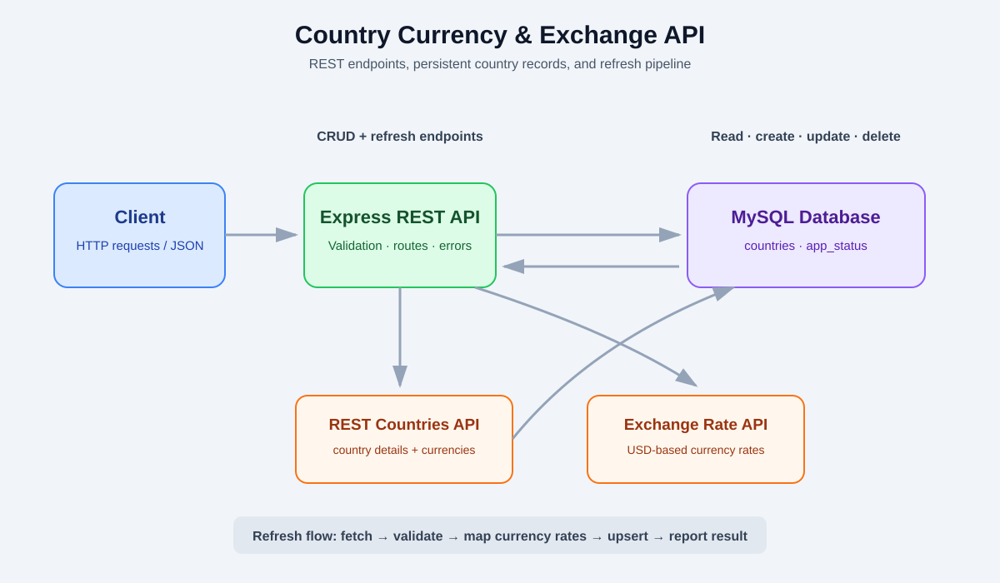

# Country Currency & Exchange API

An Express REST API that stores country details and their currency exchange-rate data in MySQL. Refresh imports country data from REST Countries and looks up the rate for each country's currency using ExchangeRate-API.



## Technologies

Node.js, Express, MySQL, mysql2, Axios, dotenv, and Sharp (for the generated country summary image).

## Setup

1. Install Node.js and MySQL, then install packages with `npm install`.
2. Create a MySQL database and a local `.env` file with the variables below. Do not commit real credentials.
3. Create/update the application's tables with `npm run setup-db`.
4. Start the API with `npm start` (or `npm run dev` for nodemon).

```dotenv
PORT=3000
DB_HOST=127.0.0.1
DB_USER=your_mysql_user
DB_PASSWORD=your_mysql_password
DB_NAME=country_currency
DB_PORT=3306
# Optional; set true only if your database endpoint requires TLS
DB_SSL=false
```

For external Railway connections, set `DB_HOST` and `DB_PORT` to the hostname and port shown for the database's public TCP proxy. Do not use Railway's private `.railway.internal` hostname from a local machine. Set `DB_SSL=true` only if the endpoint requires TLS.

The setup script creates `countries` and `app_status` if absent and adjusts nullable country fields for countries without a currency. It does not delete rows. The MySQL account must be allowed to create/alter tables during setup. Existing databases can be retained; setup does not reset them.

## API

All API responses are JSON except the summary image. Country lookup and delete use the country name (case-insensitive).

| Method | Path | Description |
| --- | --- | --- |
| GET | `/status` | Database-backed country count and last refresh timestamp |
| POST | `/countries/refresh` | Fetch external data and upsert country records |
| POST | `/countries` | Create a country |
| GET | `/countries` | List countries; optional `region`, `currency`, and `sort` filters |
| GET | `/countries/:name` | Read one country |
| PUT | `/countries/:name` | Update supplied country fields |
| DELETE | `/countries/:name` | Delete a country |
| GET | `/countries/image` | View generated summary PNG |

Supported sort values: `gdp_desc`, `gdp_asc`, `population_desc`, `population_asc`, `name_asc`.

### Create example

```http
POST /countries
Content-Type: application/json
```

```json
{
  "name": "Exampleland",
  "capital": "Sample City",
  "region": "Example Region",
  "population": 120000,
  "currency_code": "USD",
  "exchange_rate": 1,
  "estimated_gdp": 120000,
  "flag_url": "https://example.test/flag.svg"
}
```

Returns `201` and the inserted country row. Name and non-negative whole-number population are required. Other fields may be omitted or set to null.

### Read examples

`GET /countries?region=Africa&currency=NGN&sort=population_desc`

`GET /countries/Nigeria`

Example country response:

```json
{
  "id": 1,
  "name": "Exampleland",
  "capital": "Sample City",
  "region": "Example Region",
  "population": 120000,
  "currency_code": "USD",
  "exchange_rate": "1.000000",
  "estimated_gdp": "120000.0000",
  "flag_url": "https://example.test/flag.svg"
}
```

### Update and delete examples

```http
PUT /countries/Exampleland
Content-Type: application/json
```

```json
{"capital":"New Sample City"}
```

Returns the updated row. `DELETE /countries/Exampleland` returns `{"message":"Country deleted successfully"}`. Missing countries return `404`; invalid JSON or fields return `400`; duplicate create names return `409`.

### Refresh

`POST /countries/refresh` retrieves `name,capital,region,population,flag,currencies` from `https://restcountries.com/v2/all?fields=name,capital,region,population,flag,currencies`. It requests exchange data for each currency at `https://open.er-api.com/v6/latest/{CURRENCY_CODE}`. Countries without a currency or a rate are retained with null currency/rate fields. Rows are inserted or updated by country name; refresh never deletes rows. External failures return `503`, and database failures return `500`.

Successful refresh response:

```json
{"message":"Countries refreshed successfully","total_countries":250}
```

Country population, currency and rate data is sourced externally and will change over time. Exchange rates are retrieved relative to USD.
